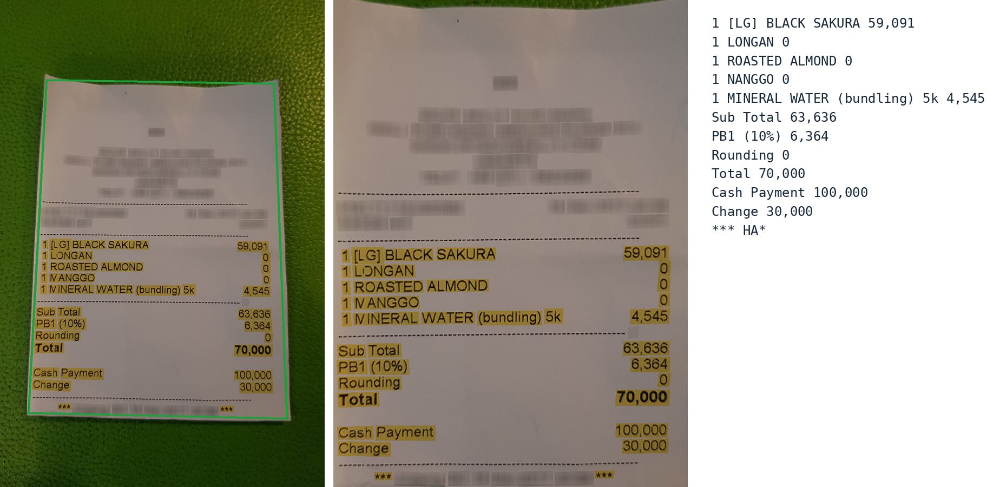
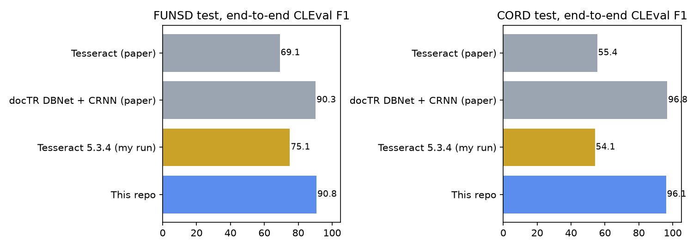
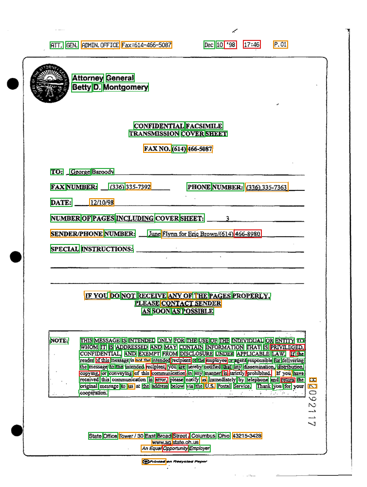
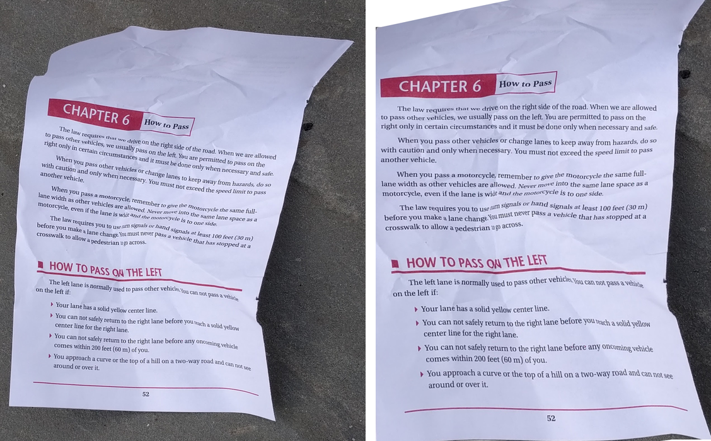

# document-ocr-engine

An OCR engine I wrote from scratch in Python. You give it a phone photo or a scan of a document. It finds the page, flattens it and reads every word, with a box for each one.

Live demo: https://huggingface.co/spaces/adwitiyashukla/document-ocr-engine. It runs both models right in your browser, so the photo you try never gets uploaded.



All the image processing is my own NumPy code, from edges and Hough lines to homographies, warps, binarization, connected components and page dewarping. The text detector and the text reader are my own PyTorch models, trained on CPU only with no GPU. The metrics are my own code too, and the tests check them against the official implementations. OpenCV is only used in the tests, to check my image functions against it.

## Results

I tested on the official test splits of FUNSD (50 scanned forms) and CORD v2 (100 receipt photos). The main metric is end-to-end CLEval F1. It is the metric used in "Text Detection Forgot About Document OCR" (Olejniczak and Sulc, 2023), so the paper rows below are directly comparable. I also ran Tesseract 5.3.4 on the exact same pages myself.

| System | FUNSD | CORD |
|---|---|---|
| Tesseract (paper) | 69.09 | 55.43 |
| Tesseract 5.3.4 (my run) | 75.06 | 54.08 |
| docTR DBNet + CRNN (paper) | 90.30 | 96.75 |
| This repo | 90.78 | 96.07 |
| This repo, ONNX int8 | 90.88 | 96.03 |

My pipeline beats the paper's docTR DBNet + CRNN on FUNSD and lands 0.68 below it on CORD. Everything here was trained from scratch on CPU. The reader trained on 2 cores and the detector on my 10 core laptop. The fp32 ONNX export scores exactly the same as PyTorch to two decimals, and int8 moves the scores by 0.1 or less.



More detail:

| Metric | FUNSD | CORD |
|---|---|---|
| Detection CLEval F1 | 95.21 | 98.41 |
| End-to-end CLEval precision | 90.95 | 95.37 |
| End-to-end CLEval recall | 90.62 | 96.78 |
| Word accuracy on the true word boxes | 83.15% | 90.24% |
| Tesseract 5 word accuracy on the same boxes | 73.33% | 60.95% |
| Character error rate on the true word boxes | 5.94% | 4.44% |
| Tesseract 5 character error rate on the same boxes | 11.10% | 18.41% |



One FUNSD test form. Green words match the ground truth exactly and red ones are misread. Orange boxes did not match a single ground truth word at IoU 0.5, usually because my detector split or merged words differently from the FUNSD labels (like "IF YOU" in one box).

Page finding on the 37 CORD test photos that have page corner labels:

| Method | Mean IoU | Median IoU | Pages with IoU of 0.9 or more |
|---|---|---|---|
| Whole image | 0.684 | 0.669 | 21.6% |
| Edges and paper color only | 0.848 | 0.887 | 45.9% |
| Seeded with the detected words | 0.894 | 0.921 | 56.8% |

I also tested flattening on DocUNet, which has 130 phone photos of bent and crumpled pages along with flatbed scans of the same pages. MS-SSIM is the usual image similarity score for this benchmark. The paper rows are learned dewarping networks, as reported in the DocScanner paper (Feng et al., 2021).

| Method | MS-SSIM |
|---|---|
| Photo as taken (paper) | 0.2459 |
| Photo as taken (my run) | 0.2500 |
| My flattening | 0.3744 |
| DocUNet (paper) | 0.4103 |
| DewarpNet (paper) | 0.4735 |
| DocTr (paper) | 0.5105 |

My MS-SSIM code gives 0.2500 for the untouched photos, close to the 0.2459 in the papers, so the rows line up. My flattening has no training at all and only straightens the text lines it can see, so it lands below the networks above, which learn to undo page warps from large synthetic datasets on a GPU. It still helps OCR. Tesseract's character error rate against the text of the scans drops from 51.6% to 32.9% on the 25 documents DewarpNet used for its OCR test, and from 48.4% to 28.7% on the 30 that DocTr used.



Speed on CPU, averaged over 20 test pages (10 FUNSD forms and 10 CORD receipts) on a 2 core Intel Xeon cloud VM. The times cover detection plus reading, without page finding.

| Engine | Detector file | Reader file | Detection | Reading | Total per page |
|---|---|---|---|---|---|
| PyTorch | 5.4 MB | 10.1 MB | 779 ms | 736 ms | 1515 ms |
| ONNX fp32 | 5.4 MB | 10.0 MB | 646 ms | 542 ms | 1187 ms |
| ONNX int8 | 1.4 MB | 5.2 MB | 572 ms | 488 ms | 1060 ms |

The browser demo runs the fp32 files on a single thread. In headless Chromium on the same VM, the example receipts take 1.8 to 2.9 s each with page flattening included, and a dense FUNSD form takes 3.8 to 4.8 s.

## How it works

1. Detection. A DBNet with a small ResNet backbone and an FPN predicts a text probability map and a threshold map. Boxes come from the probability map with a min-area rectangle per region, grown back by the unclip ratio. The loss is the DB loss with 3:1 hard negative mining.
2. Reading. Each word is cut out with a perspective warp to a 32 pixel high crop. The CRNN is a VGG style CNN with a 2 layer BiLSTM, trained with my own CTC loss, and it decodes with greedy or prefix beam search.
3. Reading order. Words get chained into lines by their direction, height and spacing. Lines that share a row are joined, then sorted top to bottom.
4. Page finding. The page is found from the detected words. I sample the paper color in a ring around the words, keep the pixels that match it and take the outer quad of the region that holds the most words. A homography then makes the page flat and square.
5. Flattening. For curved pages I group the words into text lines and fit a 2D polynomial that makes every line straight. I solve it with my own Levenberg-Marquardt and use the result to unwarp the page. It only runs when the lines are actually bent, and the model is held fixed outside the text it was fitted on, so flat receipts and wide margins stay put.
6. Training data. Real words from FUNSD and CORD, plus a synthetic data engine with 88 open fonts. It renders forms and receipts, adds scan and phone photo effects, and bends pages with a curl model.
7. Export. Both models export to ONNX. The detector uses static int8 quantization, calibrated on crops of validation pages. For the reader I only quantize the LSTM and the output layer with dynamic int8, because quantizing its convolutions the same way made it about 4x slower on CPU.

## The browser demo

The demo is a static page with no server behind it. The two fp32 ONNX models run on ONNX Runtime Web inside a Web Worker, and I ported the rest of the pipeline to JavaScript, including the resize, box extraction, word crops, CTC decoding, reading order and page finding. I copied the float32 rounding of the NumPy code step by step, so on the 15 test pages I checked it returns exactly the same boxes, words and page corners as the Python engine. The code is in `space/`.

## Run it

Every setting is in `config.toml`, and the config is checked when it loads.

```
pip install -e .
python -m docr fonts
python -m docr download
python -m docr prepare
python -m docr cache
python -m docr synth --pages 1500
```

That gets the fonts and the three datasets, cuts the word crops and page caches, and renders the synthetic pages. Then train and test:

```
python -m docr train-reader
python -m docr train-detector
python -m docr export
python -m docr evaluate --tesseract
```

To read your own document:

```
python -m docr read photo.jpg --out boxes.png
```

It prints the text in reading order, saves the word boxes to `boxes.png` and saves the flattened page to `boxes_page.png`.

To run the browser demo locally, copy `runs/onnx/dbnet.onnx` and `runs/onnx/crnn.onnx` into `space/models/` and serve the folder:

```
python -m http.server 8000 -d space
```

The tests need the dev extras:

```
pip install -e ".[dev]"
pytest
```

## Layout

| File | Contents |
|---|---|
| `docr/imaging.py` | filters, morphology, connected components, resize, remap |
| `docr/edges.py` | Canny edges and Hough lines |
| `docr/geometry.py` | homographies, warps, convex hulls, polygon clipping and IoU |
| `docr/scan.py` | binarization, page finding, rectify, deskew |
| `docr/dewarp.py` | text lines and the curved page model |
| `docr/synth.py` | fonts, text, forms and receipts, scan and photo effects |
| `docr/dbnet.py` | detector model, training targets, loss, box extraction |
| `docr/readers.py` | CRNN reader, charset and crop preprocessing |
| `docr/ctc.py` | CTC loss, greedy and beam search decoding |
| `docr/train.py` | data caches and training loops |
| `docr/pipeline.py` | the full engine on PyTorch or ONNX |
| `docr/export.py` | ONNX export and int8 quantization |
| `docr/cleval.py` | CLEval metric |
| `docr/metrics.py` | word F1, CER, matching, MS-SSIM |
| `docr/evaluate.py` | benchmark runs |
| `docr/tesseract.py` | Tesseract baseline |
| `docr/datasets.py` | dataset download and loaders |
| `docr/figures.py` | README figures |
| `docr/config.py` | config checks |
| `docr/cli.py` | command line |
| `space/` | the browser demo: JavaScript pipeline, page and styles |
| `tests/` | tests |

## Data

None of the training or test data is in the repo, apart from the four CORD receipts the demo uses as examples. `python -m docr download` gets everything from the original sources.

- [FUNSD](https://guillaumejaume.github.io/FUNSD/) (Jaume et al., 2019): 199 scanned forms, 149 for training and 50 for testing. For non-commercial research and educational use only.
- [CORD v2](https://huggingface.co/datasets/naver-clova-ix/cord-v2) (Park et al., 2019): 1,000 Indonesian receipt photos, 800 for training, 100 for validation and 100 for testing. CC BY 4.0.
- [DocUNet](https://www3.cs.stonybrook.edu/~cvl/docunet.html) (Ma et al., 2018): 130 phone photos of 65 bent and crumpled documents, each with a flatbed scan of the same page.
- Fonts: 88 Google Fonts under the OFL or Apache 2.0 license, downloaded by `python -m docr fonts`.

To validate during training I held out the last 15 FUNSD training forms and used the CORD validation split.
